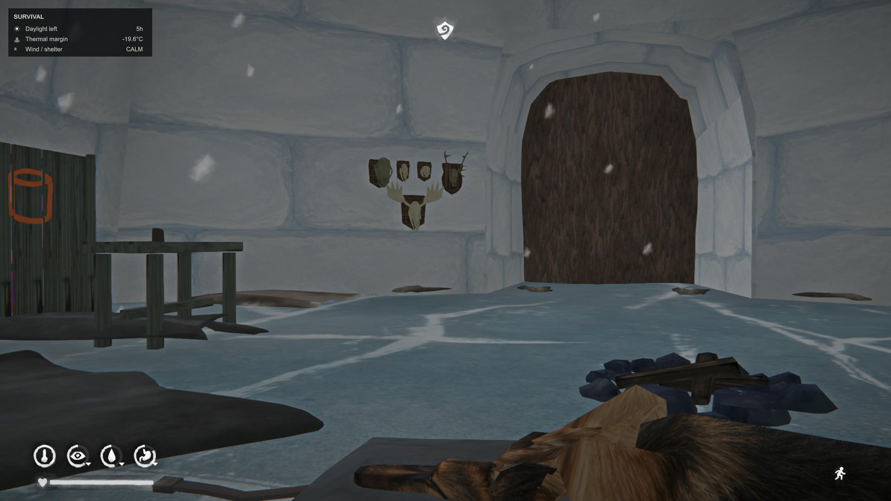
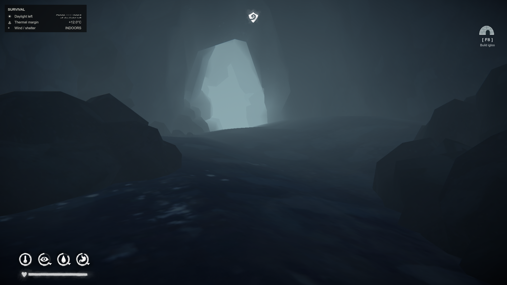
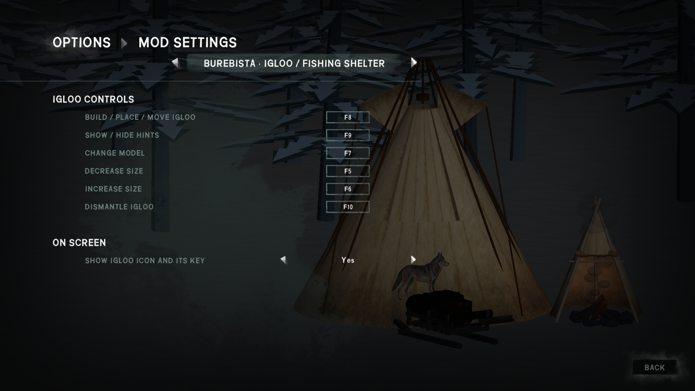

# Burebista Fishing Shelter / Igloo · 1.16.1

[Descargar / Download v1.16.1](https://github.com/florynstefanache-source/BurebistaFishingShelter/releases/latest) · [English](#english)

## Español

**Nuevo en 1.16.1:** icono discreto del iglú en la esquina superior derecha, con la tecla configurada y el texto Construir/Mover. Se oculta en los menús. Puedes desactivarlo en Mod Settings con «Mostrar icono del iglú y su tecla». Es un recordatorio visual: pulsa la tecla indicada para usarlo. No necesita cursor ni se pulsa con el ratón.

Refugio de pesca e iglú para The Long Dark. Esta actualización cambia la receta del iglú y añade controles configurables desde Mod Settings, con ayudas en español o inglés según el idioma del juego.

### Instalación

1. Cierra el juego y conserva una copia de tu partida y de los DLL anteriores.
2. Copia el contenido de `Mods` de este ZIP dentro de `TheLongDark/Mods`, aceptando reemplazar los archivos.
3. Actualiza juntos `BurebistaFishingShelter.dll`, `IgluAddon.dll` y **`BurebistaSnowBlocks.dll` 0.1.9 incluido**. No dejes copias antiguas de estos DLL con otros nombres dentro de Mods.
4. Conserva tus archivos de partidas, `states-v2`, `shelter-v1.state` y los datos de ModData. No borres la carpeta del refugio.

Requiere MelonLoader y **ModSettings.dll**. El almacén opcional necesita además **ModData.dll**. Esas dependencias no se incluyen. El paquete incluye los modelos y texturas del refugio y su módulo Effects original. Compilado con las bibliotecas locales de TLD 2.55 / MelonLoader 0.7.2.

### Nueva receta del iglú

**40 bloques enteros de nieve + 1 piel curada de ciervo para la puerta.**

- Ya no exige palos ni telas para el iglú.
- Los bloques deben estar completos: un bloque empezado para derretir agua no sirve para construir. Los montones de nieve de 0,5 L tampoco cuentan.
- Cuenta los bloques de la mochila y los bloques sueltos a un máximo de 8 metros del jugador. La piel curada debe estar en la mochila.
- Si faltan materiales, muestra un aviso y no construye. Los bloques se reservan al colocar y se consumen al crear el refugio; si no llega a colocarse, se restablece la reserva.
- Recolocar un iglú existente no vuelve a cobrar la receta. Las construcciones guardadas se restauran sin cobrar materiales.
- Al desmontarlo devuelve una piel curada; no devuelve los bloques de nieve.

Snow Blocks 0.1.9 reconoce que este IgluAddon gestiona la receta y evita aplicar su antigua intervención sobre ella. Por eso se suministran juntos. El cambio de Snow Blocks se limita a esa compatibilidad; mantiene el sistema de agua, animación y avisos de nieve al estar agachado.

### Elegir tus teclas en Mod Settings

Abre **Opciones → Mod Settings → Burebista · Igloo / Fishing Shelter**. Pulsa el botón de la tecla, asigna otra y **confirma** para guardarla. Estos son los seis controles configurables:

| Acción configurable | Valor inicial |
|---|---|
| Construir / colocar / mover el iglú | F8 |
| Mostrar / ocultar ayudas | F9 |
| Cambiar modelo | F7 |
| Reducir tamaño | F5 |
| Aumentar tamaño | F6 |
| Desmontar | F10 |

Puedes sustituirlos por teclas normales, Insert, Home, End, etc. Se rechazan duplicados entre estos seis controles, teclas de movimiento, E/B/T/G/U, modificadores y botones del ratón. Evita también teclas ocupadas por otros mods: no se detectan automáticamente. Las ayudas de construir y ocultar muestran las teclas que hayas elegido.

Las ayudas, avisos y nombres de estos ajustes usan inglés si el idioma del juego es English; en español usan español. El título del mod conserva su nombre.

### Uso y mejoras

E abre/cierra la puerta; B permite descansar en el saco. Las mejoras se fabrican por separado y conservan sus recetas:

| Mejora | Construir | Materiales | Usar |
|---|---|---|---|
| Mesa | Ctrl+J | 6 maderas recuperadas, 4 chatarras, 2 telas | T |
| Bastidor de curado | Ctrl+K | 12 palos, 4 tripas curadas, 2 telas | G |
| Almacén de 500 kg | Ctrl+U | 12 maderas recuperadas, 6 chatarras, 4 telas, 4 tripas curadas | U |

Suelta materiales frescos cerca del bastidor y pulsa G: cuatro sitios para pieles/tripas y dos para retoños. Recógelos seleccionándolos. Vacía el almacén y recoge los materiales del bastidor antes de mover, redimensionar o desmontar. Guarda después de construir o cambiar el contenido del almacén.

### Comprobaciones

Compilación sin errores de los módulos modificados; 60 pruebas de estado/guardado, 189 comprobaciones de reglas de nieve y pruebas de idioma existentes, y 16 comprobaciones de teclas, idioma e interfaz con Snow Blocks. Las pruebas no ejecutan el juego: la colocación y el menú nativo requieren comprobarse dentro de tu partida.

## English

**New in 1.16.1:** a small igloo icon in the upper right corner shows your configured key and Build/Move caption. Hidden in menus. Disable it with “Show igloo icon and its key” in Mod Settings. It is a visual reminder: press the displayed key to use it. No mouse cursor or clicking is needed.

Fishing shelter and igloo for The Long Dark. This update changes the igloo recipe and adds configurable controls in Mod Settings. Hints use Spanish or English according to the game language.

### Installation

1. Close the game and keep a backup of your save and previous DLLs.
2. Copy this ZIP's `Mods` contents into `TheLongDark/Mods`, replacing the existing files.
3. Update `BurebistaFishingShelter.dll`, `IgluAddon.dll` and the **included `BurebistaSnowBlocks.dll` 0.1.9 together**. Do not keep renamed copies of older DLLs in Mods.
4. Keep your saves, `states-v2`, `shelter-v1.state` and ModData data. Do not delete the shelter folder.

Requires MelonLoader and **ModSettings.dll**. Optional storage also requires **ModData.dll**. These dependencies are not included. The package contains the shelter models/textures and its original Effects module. Built against local TLD 2.55 / MelonLoader 0.7.2 libraries.

### New igloo recipe

**40 whole snow blocks + 1 cured deer hide for the door.**

- Sticks and cloth are no longer required for the igloo itself.
- Partly melted blocks cannot be used for construction. Loose 0.5 L snow piles do not count either.
- Counts blocks in your backpack and loose blocks within 8 metres of the player. Keep the cured hide in your backpack.
- Missing materials prevent construction and display a message. Blocks are reserved during placement and consumed when the shelter is created; failed placement releases the reservation.
- Moving an existing igloo does not charge the recipe again. Restoring a saved shelter does not consume materials.
- Dismantling returns one cured hide; snow blocks are not returned.

Snow Blocks 0.1.9 detects that this IgluAddon handles the recipe and skips its older recipe intervention, preventing a double charge. Update both together. Its other systems—water, animation and crouching snow hints—remain as before.

### Choose your keys in Mod Settings

Open **Options → Mod Settings → Burebista · Igloo / Fishing Shelter**. Click a key button, assign your preferred key and **confirm** to save. These are the six configurable controls:

| Configurable action | Default |
|---|---|
| Build / place / move igloo | F8 |
| Show / hide hints | F9 |
| Change model | F7 |
| Decrease size | F5 |
| Increase size | F6 |
| Dismantle | F10 |

Use ordinary keys, Insert, Home, End, etc. Duplicate assignments among these controls, movement keys, E/B/T/G/U, modifiers and mouse buttons are rejected. Also avoid keys used by other mods; those conflicts cannot be detected automatically. Build and hide hints display your selected keys.

Hints, messages and these settings labels use English when the game language is English; Spanish uses Spanish. The mod title retains its name.

### Use and upgrades

E opens/closes the door; B rests in the bedroll. Upgrades remain separate constructions with their existing recipes:

| Upgrade | Build | Materials | Use |
|---|---|---|---|
| Workbench | Ctrl+J | 6 reclaimed wood, 4 scrap metal, 2 cloth | T |
| Curing rack | Ctrl+K | 12 sticks, 4 cured guts, 2 cloth | G |
| 500 kg storage | Ctrl+U | 12 reclaimed wood, 6 scrap metal, 4 cloth, 4 cured guts | U |

Drop fresh materials beside the rack and press G: four hide/gut slots and two sapling slots. Select items to pick them up. Empty storage and collect rack materials before moving, resizing or dismantling. Save after building storage or changing its contents.

### Verification

Modified modules build without errors; 60 state/save tests, 189 snow-rule checks and existing language checks pass, plus 16 key, language and Snow Blocks interface checks. Tests do not run the game; placement and the native settings menu still need in-game verification.

## Capturas / Screenshots

Icono del iglú y tecla elegida / Igloo icon and selected key.

Controles configurables y opción para ocultar el icono / Configurable controls and icon visibility option.

Las capturas muestran otros mods del jugador, incluidos trofeos y perro/trineo, que no forman parte de esta descarga. / Screenshots also show the player’s other mods, including trophies and dog/sled, which are not included in this download.
